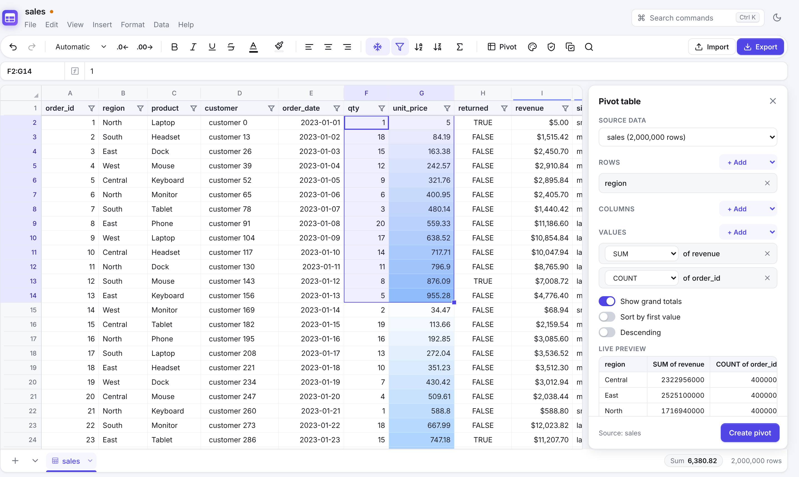
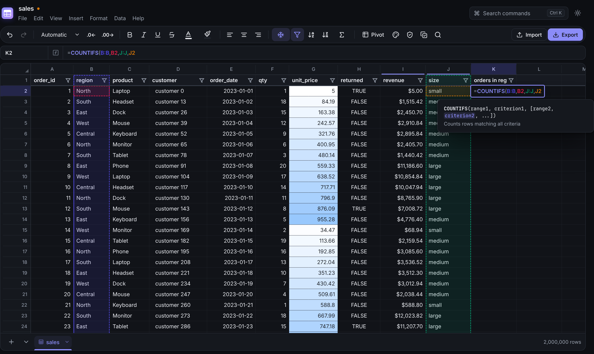

# PySheets

A fast desktop spreadsheet for **millions of rows**, an alternative to Row Zero and
Microsoft Excel for big data. Data lives in an embedded **DuckDB** database, and formulas
compile to vectorised SQL. The UI is a canvas-rendered grid in a native Windows window
(Edge WebView2).




## Features

| Area | What you get |
| --- | --- |
| **Scale** | Opens multi-million-row CSV / Parquet files in under a second; scrolling fetches only the visible block (about 2–5 ms per block). Custom scrolling has no browser height limit. |
| **Import** | CSV/TSV (auto-detected delimiter and header), Excel (`.xlsx .xlsm .xls .xlsb .ods`, every tab), Parquet, JSON/NDJSON, SQLite, DuckDB, and any SQL database through a SQLAlchemy URL (PostgreSQL, MySQL, SQL Server…), by table or by custom query. Drag and drop files onto the window. |
| **Export** | One tab or the whole workbook to Excel (streams through a Rust writer and splits sheets over 1,048,576 rows), CSV, TSV, Parquet, JSON, SQLite, DuckDB, a portable SQL script, or straight into a database server. |
| **Formulas** | About 150 functions with Google Sheets semantics: `SUM… COUNTIF(S) SUMIF(S) AVERAGEIF(S) MAXIFS MINIFS`, `VLOOKUP HLOOKUP XLOOKUP INDEX MATCH CHOOSE`, `FILTER SORT SORTN UNIQUE QUERY ARRAYFORMULA SEQUENCE SPLIT TRANSPOSE FLATTEN`, text (`TRIM PROPER SUBSTITUTE REGEX* TEXT TEXTJOIN…`), dates, logic, statistics. Results **spill** like Sheets/Excel 365. |
| **Column formulas** | Type a formula and press **Ctrl+Enter** (or double-click the fill handle). It is applied to the whole column as **one** SQL query: `=D2*E2` or `=COUNTIF(B:B,B2)` over 2,000,000 rows takes about 0.1–0.6 s. Running totals (`=SUM($E$2:E2)`) become window functions. |
| **Editing** | Typed columns, fill handle (series and formulas), copy/cut/paste (internal paste keeps formulas and shifts references), multi-range selection, insert/delete rows and columns with reference rewriting, undo/redo for everything. |
| **Formula UX** | Syntax highlighting, colour-matched reference outlines on the grid, click-to-insert references (including from other tabs), function autocomplete with signature help, auto-closing parentheses, error tooltips. |
| **Filter-safe editing** | With a filter on, clear, delete rows, paste (line by line into visible rows), copy, fill down/drag-fill, column fills, formatting and text cleanup touch **only the visible rows**. Hidden rows are never changed. |
| **Format-tolerant lookups** | `VLOOKUP`/`XLOOKUP`/`MATCH`/`COUNTIF`/`FILTER` match keys that differ only in format (number vs text, spaces, leading zeros, separators, hidden characters), mark those cells with an amber corner and report exact / format-only / really-missing counts. **Data → Check key matches** explains every mismatch and normalises both key columns in one step; Strict mode is one click away. |
| **Data tools** | Filter (by values with counts, or by condition), sort, pivot tables with a live preview (they refresh when the source changes), find & replace (case, whole cell, regex, all tabs), duplicate detection (count / highlight / mark / remove), data validation (dropdowns, checkboxes, number/date/text rules, e-mail, URL, regex, unique, custom formula; warn or reject) with an invalid-cell report, text cleanup (trim, case, non-printing), split text to columns, column statistics. |
| **Formatting** | Number formats (currency, percent, dates, scientific, custom), bold/italic/underline/strike, text and fill colours, alignment, conditional formatting (comparisons, text, blanks, duplicates/unique, top/bottom N, above/below average, colour scales, custom formula). |
| **Borders & merges** | Border picker (all, outer, inner, horizontal, vertical, each side, none) with thin, medium, thick, dashed, dotted and double lines in any colour. Merge all / horizontally / vertically / unmerge; merged cells select, edit and move as one block. |
| **Google Sheets** | Import a tab as a **linked sheet** and press **Refresh** to pull the latest data. **Consolidate** the same tab from a list of spreadsheets (a directory sheet, a tab in this workbook, or pasted IDs) into one table with source columns and a refresh log. Refreshing re-reads the list, so new IDs are picked up. |
| **Python scripts** | An Apps Script-style editor (**Extensions → Python scripts**) with macros, custom formula functions and "run my existing `.py` file" scripts. Scripts are saved inside the workbook. Every tab is a SQL table for DuckDB and a pandas DataFrame. |
| **Layout** | Freeze rows/columns, multiple tabs (rename, reorder by drag, duplicate, delete), column resize and autofit, row density, light/dark theme, command palette (**Ctrl+K**). |
| **Help & updates** | **Help → Documentation** (<kbd>F1</kbd>) is a searchable guide to every feature and all functions, available offline. **Help → Check for updates…** shows your version and installs a newer release in one click. Nothing updates automatically. |
| **Files** | Native `.pysheets` workbook (a single DuckDB file that keeps data, formulas, formats, rules, links and scripts). Workbooks are saved in **`Documents\PySheets`** and exports in `Documents\PySheets\Exports`. Both are created automatically, the Save/Open dialogs start there, and **File → Open PySheets folder** opens it in Explorer. |

## Install (Windows)

Every push builds the Windows app in GitHub Actions (**Actions → Windows app → Artifacts**):

* `PySheets-Setup-<version>.exe`: installer with a Start-menu entry and `.pysheets` file association.
* `PySheets-<version>-windows-x64.zip`: portable folder; run `PySheets.exe`.

To make **Sign in with Google** work without a `credentials.json` step, add a repository secret
`GOOGLE_OAUTH_CLIENT_JSON` containing a Desktop-app OAuth client JSON. The Windows build bundles it.

To publish a GitHub Release, run **Actions → Windows app → Run workflow** and enter a version
such as `v0.5.0` in *release*; the workflow creates the tag and attaches both files. Pushing a
`v*` tag does the same.
The app needs the Microsoft Edge WebView2 runtime, which ships with Windows 10 and 11.

## Run from source

```bash
uv sync --all-extras                # Python deps (duckdb, pyarrow, pywebview, google-auth, …)
npm --prefix frontend ci            # UI deps
npm --prefix frontend run build     # builds the UI into src/pysheets/web
uv run pysheets data.csv            # native window
uv run pysheets --browser data.csv  # or in your default browser
```

Build the Windows executable locally:
`powershell -ExecutionPolicy Bypass -File scripts\build_windows.ps1 -Installer`.

### Development

```bash
scripts/dev.sh            # API on :8765 + Vite hot reload on http://localhost:5173
uv run pytest             # engine, formula, import/export and server tests
uv run ruff check src tests
npm --prefix frontend run typecheck
```

## Google Sheets: linked data and consolidation

**Data → Google Sheets** asks you to **sign in first**. Importing, consolidating, refreshing
and `ps.gsheet` in scripts all stay locked until you are signed in. The account e-mail then
appears in the dialog, with a sign-out button.

* **Sign in with Google.** Your browser opens Google's sign-in page. Pick the account and
  allow read-only access (`spreadsheets.readonly` plus your e-mail address for display).
  PySheets continues automatically, and the login is saved in `%LOCALAPPDATA%\PySheets\google`,
  so you only do this once. The first time, PySheets asks for an OAuth client file
  (`credentials.json`, a Google Cloud OAuth client of type *Desktop app*). You can choose the same
  file your Python scripts use. Release builds can ship with a client built in (see below),
  which skips that step.
* **Other ways to sign in.** Reuse the `token.json` saved by your existing scripts (pick their
  folder; the files are copied and the originals are untouched), or use a service-account key.
* **Expired or revoked logins.** If the login expires or is revoked, the sign-in screen
  comes back. A **Refresh** that was waiting for it runs again automatically once you are signed in.

* **Import one sheet.** Paste a link, tick tabs, and each tab becomes a linked sheet (cloud
  icon on the tab). **Refresh** (toolbar, or **Data → Refresh all linked sheets**) replaces the
  linked columns with the latest values. Columns you add yourself, such as checks or formulas,
  are kept and recalculated.
* **Consolidate many sheets.** This is the "master directory" workflow:
  1. Choose where the list of spreadsheets lives: a Google Sheet (for example the
     `app_cluster_directory` tab of your master directory), a tab in this workbook, or pasted IDs/links.
  2. Name the ID column (with an optional link column fallback and a label column, e.g. `cluster_id`) and the
     tabs to pull from each spreadsheet (e.g. `monitoring`).
  3. PySheets downloads them in parallel, matches headers ignoring case, spaces and line breaks,
     stacks them into one sheet per tab, and adds `_source_label`, `_source_spreadsheet_id`
     and `_source_row_number` columns. It also writes a log tab (status, rows, missing/extra columns,
     errors) for every source.
  4. **Refresh** re-reads the directory first, so spreadsheets added to the list are included
     in the next pull.

## Python scripts and custom functions

**Extensions → Python scripts** (or the `>_` toolbar button) opens the script editor. Scripts
are stored in the `.pysheets` file. **Ctrl+S** saves, **Ctrl+Enter** runs, and the console shows
`print` output, tracebacks and timing. There are three kinds:

| Kind | What it does |
| --- | --- |
| **Macro** | Python that runs inside PySheets with a `ps` object, `pd` (pandas) and `duckdb`. |
| **Custom functions** | Functions decorated with `@ps.function` become formula functions (`=HHID_OK(C2)`), with autocomplete. Plain functions run per row. `@ps.function(vectorized=True)` receives whole columns as pandas Series and is fast on millions of rows. Type hints (`str float int bool date`) set the types. |
| **Run a .py file** | Runs an existing script, for example your pipeline's `00_run_..._pipeline.py`, with arguments and a working folder, streaming its output to the console. By default it uses the Python on your `PATH`, so your installed packages are available. Otherwise it uses the Python bundled with PySheets (pandas, DuckDB, google-auth, gspread, gspread-dataframe, openpyxl, tqdm, requests). |

```python
ps.sheets()                          # tab names
df = ps.sheet("Sales").df()          # tab -> pandas DataFrame (row 1 = column names)
ps.sql('SELECT region, sum(total) FROM "Sales" GROUP BY 1')   # every tab is a SQL table
ps.new_sheet("Report", df)           # DataFrame -> new/replaced tab
sh = ps.sheet("Report")
sh.set("F1", "=SUM(E:E)")            # cells, formulas
sh.append(more_rows_df)              # append, matching columns by header
ps.gsheet(url_or_id, "monitoring")   # read a Google Sheets tab with your saved credentials
ps.refresh_all()                     # refresh every linked / consolidated tab
ps.read("C:/data/file.parquet")      # read any file DuckDB can read
ps.run_file("C:/scripts/check.py", "--flag")   # run another script
ps.progress(i, n, "Pulling…"); ps.toast("Done")
```

Templates in the **New script** menu cover consolidating from a directory, data-quality
checks in SQL, custom functions, and running an existing file.

**Security.** Scripts run with full access to your computer, like any Python script. A
workbook opened from elsewhere keeps its scripts **off** (custom functions show `#NAME?`) until
you review the code and click **Enable scripts**.

## How it works

```
┌────────────── Native window (pywebview → WebView2) ──────────────┐
│  React chrome + canvas grid (frontend/)                           │
│  • block cache (128 rows × 48 cols), stale-while-revalidate       │
│  • custom eased scrolling, frozen panes, animated selection       │
└──────────────── JSON-RPC over http://127.0.0.1 (token) ──────────┘
                                   │
┌──────────────────────────── Python engine ───────────────────────┐
│ formula/   parser → compiler → DuckDB SQL (scalar, row, array)    │
│ engine/    sheets = DuckDB tables (__rid + typed columns),        │
│            spills, dependency-ordered recalc, undo snapshots,     │
│            filters/sort/pivot/validation/formatting, import/export│
└───────────────────────── DuckDB (in-memory, spills to disk) ─────┘
```

* **Row 1 is the header row.** Each tab is a typed DuckDB table, and row 1 holds the
  column names, so `A1` references and ranges like `A:A` / `A2:A` behave like Google Sheets.
* **Formulas compile to SQL.** A cell formula becomes one `SELECT`. Ranges become
  relations, and lookups become correlated sub-queries that DuckDB turns into hash joins.
  A column formula is evaluated by one `UPDATE` (or a window query) over the whole column.
* **Recalculation** tracks which regions each formula reads and writes, then recomputes
  only the affected formulas in topological order. It detects cycles and spill collisions.
* The local server binds to `127.0.0.1` and requires a random per-launch token, so
  other web pages can't call it.

## Differences from Google Sheets / Excel (current limitations)

* **Error values.** Errors inside vectorised formulas become blank cells instead of
  `#N/A`/`#DIV/0!`. `IFERROR`/`IFNA` still work, and errors from a single-cell formula
  are shown with a tooltip.
* **Mixed-type columns.** Columns are typed, so a column that mixes numbers and text is
  stored as text. Numeric formulas still read numeric-looking text.
* **Excel export writes values**, not formulas.
* **QUERY** supports `select, where, group by, pivot, order by, limit, offset, label`.
* **Sorting** a range that crosses vertically merged cells is refused (unmerge first).
* **Google Sheets links are read-only.** PySheets pulls data and does not write back. A Google
  account is required. Sheets shared as "anyone with the link" are also read through that account.
* **Not yet supported:** charts, per-row heights, hidden rows/columns (use filters),
  comments, named ranges, `INDIRECT`/`OFFSET`/`LAMBDA`, iterative calculation,
  real-time collaboration.

## Keyboard shortcuts

`Enter`/`F2` edit · `Ctrl+Enter` fill formula down the column · `Ctrl+D` fill down ·
`Ctrl+Z`/`Ctrl+Y` undo/redo · `Ctrl+C/X/V` clipboard · `Ctrl+B/I/U` styles ·
`Ctrl+F`/`Ctrl+H` find/replace · `Ctrl+K` command palette · `Ctrl+Shift+L` filter ·
`Ctrl+Arrow` jump to data edge · `Ctrl+Space`/`Shift+Space` select column/row ·
`Ctrl+PgUp/PgDn` switch tab · `Ctrl+O` open · `Ctrl+S` save · `Ctrl+Shift+E` export ·
`Ctrl+/` all shortcuts · in the script editor `Ctrl+Enter` run, `Ctrl+S` save.

## License

MIT
